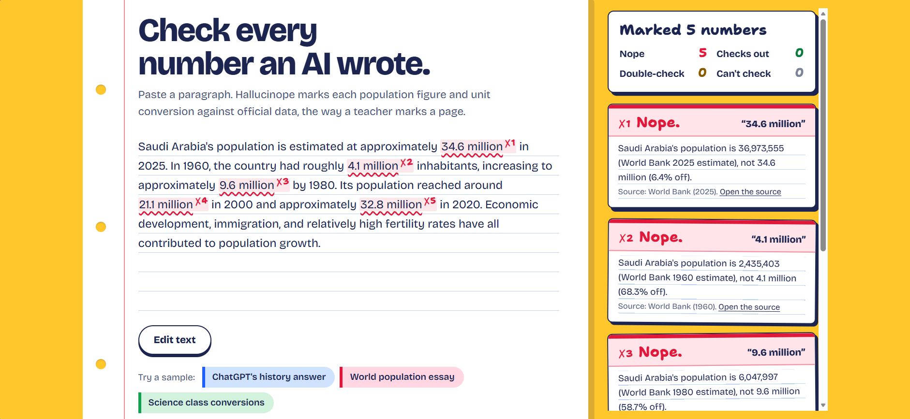
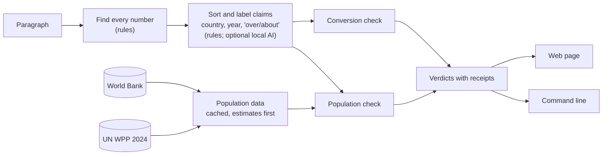

# Hallucinope

**Your AI writes the words. Real data checks the numbers.**

Hallucinope checks every number in a paragraph (from ChatGPT, an essay, your notes) against official data, and marks it the way a teacher marks a page: wrong numbers get a red **"Nope."** with the real figure and its source.



*Above: a paragraph ChatGPT wrote when asked to be accurate. All five numbers are wrong; one is off by 68%.*

## The finding that started it

In testing, I asked ChatGPT to write accurate paragraphs about country populations. Then I asked it, in fresh chats, to find the wrong numbers in those same paragraphs.

- Its "accurate" paragraphs contained **16 population errors**, up to **68% off** (Saudi Arabia, 1960: it wrote 4.1 million; the World Bank figure is 2.4 million).
- When asked to check those paragraphs, ChatGPT **found none of the 16**. (In some copies of the paragraphs where another number had been altered, it flagged 3 or 4 of them, inconsistently.)
- Hallucinope found **all 16**, each with its official source.

Checking from memory is not checking. Hallucinope never supplies a number from memory: every figure it shows comes from the World Bank or the UN, and every verdict says which.

## What it checks

| Claim | Checked against |
|---|---|
| Country and world populations, 1950–2100 | World Bank estimates; UN World Population Prospects 2024 for years the World Bank doesn't cover |
| Unit conversions: length, mass, temperature, speed, area, volume, kitchen units | Exact unit definitions |

Each number gets one of four verdicts:

| Verdict | Meaning |
|---|---|
| **Nope.** (red) | Official data says otherwise. Shows the real figure. |
| **Checks out** (green) | Matches the official figure, allowing for normal rounding. |
| **Double-check** (yellow) | Only a forecast to compare with, or the text cites a census count. A forecast can never make a claim "wrong". |
| **Can't check** (grey) | No official figure for that place or year. Hallucinope never guesses. |

Anything else (percentages, money, GDP, cities) is listed as *not checked*, so nothing is silently skipped.

## Results

Two benchmark rounds, each run once on code frozen beforehand (the code's fingerprint is recorded with every result). The full data, scripts and ChatGPT's answers are in [`benchmark/`](benchmark).

### Round 2: subtle errors (official result)

97 paragraphs on countries not used during development: 30 accurate, 67 with one number changed by only 7% or 12%, the size of real AI mistakes.

| | Hallucinope v1.1 | ChatGPT (free tier) |
|---|---|---|
| Population errors found | **40 / 40 (100%)** | 34 / 40 (85%) |
| Conversion errors found | 21 / 27 (78%) | **27 / 27 (100%)** |
| All errors found | 61 / 67 (91%) | 61 / 67 (91%) |
| Real errors found in ChatGPT's "accurate" paragraphs | **15** | 0 |

Being honest about it: 2 of the 40 population catches were for the wrong reason (a bug read "South America" as the USA), and 5 of the 128 claims in the accurate paragraphs got a false "Nope." from two bugs. Both are fixed in v1.2; the round 2 paragraphs are now regression tests.

**After fixes (v1.2, same paragraphs, so tuned on them):** population 39/40 (the one miss is an injected number that happened to land on the true figure), conversions 24/27, **zero false alarms** (3 borderline cases, 2.2–2.5% off the official figure), and 16 real ChatGPT errors found. The remaining misses are BTU and miles-per-gallon, which aren't supported.

### Round 1: 30% errors

78 paragraphs, 58 known errors (31 population, 27 conversion).

| | Hallucinope v1 (official) | v1.1 (after fixes) | ChatGPT (free tier) |
|---|---|---|---|
| Population errors found | **31 / 31** | **31 / 31** | 29 / 31 |
| Conversion errors found | 16 / 27 | **27 / 27** | **27 / 27** |
| False alarms on accurate text | 4 | **0** | **0** |

ChatGPT won round 1 overall. Its conversion results exposed Hallucinope's weak spot (lists like "5 m by 4 m" read as conversions), which v1.1 fixed.

### How the test errors were made

I first asked ChatGPT to plant errors and give an answer key. **About half of its 31 "planted errors" were correct numbers**, and in a stricter retry, 7 of its 11 population "errors" were identical to the "true values" it gave itself (only 1 was clearly wrong). So instead, ChatGPT wrote accurate paragraphs and a script changed one number per copy. Those errors are wrong by construction, with no answer key to trust. Which numbers to change was decided by reading the paragraphs, before anything was run ([`benchmark/build.py`](benchmark/build.py)).

### Should an AI find the claims?

I tested small local models (Qwen 3.5, 0.8B and 2B, via [Ollama](https://ollama.com)) against hand-written rules for labelling which country and year each number is about:

| | Claims fully right | Time per paragraph |
|---|---|---|
| **Rules** | **18 / 19 (95%)** | instant |
| Qwen 3.5 0.8B | 16 / 19 (84%) | 5.2 s |
| Qwen 3.5 2B | 16 / 19 (84%) | 8.6 s |

A second attempt restricted the models to choosing from countries and years that appear in the text. They then caught city populations correctly, but discarded real claims (6/19 and 9/19). So rules are the default, and the model connection stays behind a setting (`HALLUCINOPE_USE_LLM=1`) for future, stronger models.

## How it works



**Design decisions worth knowing:**

- **Rules find the numbers.** A number is only checked if it is literally in the text, so nothing downstream can work with an invented figure.
- **Estimates first.** For a year the World Bank covers, its measured estimate is used; UN projections only fill later years. A 2024 projection put Canada's 2026 population below its *measured* 2025 population; trusting the newest number would have marked true claims wrong.
- **Rounding is read from the writing.** "41.7 million" claims precision to 100,000; "40 million" only to 10 million. The allowed margin is half that step, kept between 2% and 10%, so "India has 1 billion people" doesn't pass on a technicality.
- **Typed units.** Every unit is a vector of powers of length, mass, time and temperature, so `km/h`, `m²` and `miles per hour` are derived, not listed, and "5 kg = 5 m" is refused.
- **Receipts that don't lie.** A cached figure keeps the date it was downloaded, and projections are always labelled as projections.
- **Offline.** Data is cached for 30 days; if a download fails, the last copy is used and the page says so.

## Quick start

Requires Python 3.10+. No other packages are needed to run it.

```bash
git clone https://github.com/ibraheem-s234/hallucinope.git
cd hallucinope
python -m venv .venv
.venv\Scripts\activate            # Windows (macOS/Linux: source .venv/bin/activate)
pip install -e ".[dev]"
python -m hallucinope.web         # opens the page in your browser
```

The first start downloads World Bank data (about a minute). For UN projections (2026 onwards, and 1950s figures), request a free token from the [UN Data Portal](https://population.un.org/dataportalapi/token/index.html) and put it in a `.env` file in the project folder:

```
HALLUCINOPE_UN_TOKEN=your-token-here
```

Without it, Hallucinope still works with World Bank data, and says so.

**From the command line:**

```bash
python -m hallucinope "Canada has about 38 million people. A marathon is 42 km, or about 30 miles."
python -m hallucinope --file essay.txt
```

## Testing

```bash
pytest                                              # 269 tests, no internet needed
python benchmark/run.py --details                   # round 1 benchmark
python benchmark/run.py --round round2 --details    # round 2 benchmark
python -m hallucinope.eval.extraction --models qwen3.5:0.8b   # rules vs a local model
```

The tests include every real paragraph that ever exposed a bug.

## Project layout

```
src/hallucinope/
  units/      typed dimensions, unit table, conversion
  data/       World Bank and UN sources, cache, "estimates first" lookup
  extract/    finding numbers, countries, places, comparison words; claims
  checks/     population verdict rules (rounding, census, projections)
  llm/        optional local model via Ollama, with output validation
  web/        local web server and the page
  report.py   paragraph in, verdicts out
benchmark/    test sets, scoring scripts, results, ChatGPT's answers
tests/        269 tests
```

## Limits

- Checks country and world populations only; provinces, states and cities are recognised and skipped, not checked.
- Unsupported units: energy (BTU, kWh), fuel economy (mpg), imperial gallons.
- Spelled-out numbers ("forty million") are not detected.
- Rules handle common phrasing; unusual sentences can be misread. Every verdict shows its source so it can be checked.

## Data

- World Bank, World Development Indicators, *Population, total* (SP.POP.TOTL). [data.worldbank.org](https://data.worldbank.org/indicator/SP.POP.TOTL)
- United Nations, Department of Economic and Social Affairs, Population Division (2024). *World Population Prospects 2024.* [population.un.org/wpp](https://population.un.org/wpp/)

Each provider's terms of use apply to its data.

## About

I'm a Computer Science student at Queen's University (class of 2028). I built Hallucinope in November 2026 because students increasingly use AI to help with their work, and numbers are where it fails quietly: a wrong population figure looks exactly as confident as a right one, and nothing in the text gives it away.

### How it was built

I worked with Claude (Anthropic) as a pair programmer. Claude wrote most of the code to my direction; I made the decisions about what Hallucinope should do and how, and I tested every step on my own machine. In practice:

- **The idea and its scope.** I started with a question-answering app for numeric facts, then reframed it as a fact-checker for AI-written text, and limited version 1 to populations and unit conversions so it could be done properly.
- **The judgment calls the code depends on.** Trust measured estimates before forecasts. Never let a forecast mark a claim wrong. Allow rounding between 2% and 10%, based on how the number is written. Treat census figures as "Double-check". List unchecked numbers instead of hiding them.
- **Free and private by design.** I chose open data, a local cache and an optional local model (Ollama) over paid APIs, so it costs nothing to run and your text never leaves your computer.
- **The evaluation.** I generated the benchmark paragraphs, ran every test and benchmark round, and reviewed the results. When the local AI models lost to the rules, I shipped the rules. When ChatGPT won round 1, I reported it, and fixed what it exposed.
- **The interface.** I set the direction: a school-notebook design that students from middle school to university can use without instructions, with yellow as the default look.

### What I learned

- **Test before trusting.** Every round of real AI text found bugs that my own test cases missed, so every one of those paragraphs is now a permanent test.
- **Evaluate fairly.** Freeze the code before scoring, report the first run, and label "after fixes" results as such. A benchmark you can tune to isn't a benchmark.
- **An AI can't grade its own answers.** ChatGPT's answer keys were wrong about half the time, and it missed every error in its own "accurate" paragraphs. That's why the errors in the final benchmark were created by a script instead.
- **Real data is messier than it looks.** Census counts differ from estimates, forecasts age badly, and "South America" is not America. Most of the work was in the edge cases.
